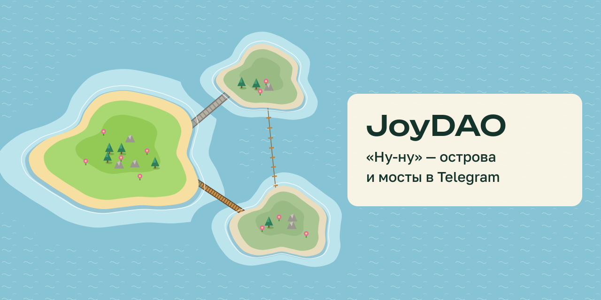

<p align="center"></p>

# JoyDAO · «Ну-ну»

**Строй мосты с людьми. По шагу в день.**

«Ну-ну» — игра в Telegram о том, насколько хорошо вы с друзьями знаете друг друга. У каждого свой остров, между друзьями растут мосты, а маленькие дела ты ставишь себе хоть каждый день — бот напомнит в нужный час. Это и игра, и заметки, и дневник.

🌱 **Главный образ — сад.** Каждое дело — семя: ты сажаешь его на своём острове, и оно ждёт в земле. Сделал в жизни — семя распускается; вышло по-другому — прорастает иначе. Игра не сделает дело за тебя: она помогает посадить намерение и не забыть о нём, а растёт оно в реальной жизни.

▶ **Играть:** [t.me/JOYDAO_bot/nunu](https://t.me/JOYDAO_bot/nunu) · сайт [joylao.duckdns.org](https://joylao.duckdns.org) · канал [@joydao](https://t.me/joydao) · общий чат [@joydao_club](https://t.me/joydao_club)

*English below.*

## Как это работает

- 🏝 **Твой остров.** Отвечаешь на карточки-сцены, и остров растёт из ответов: цветы — когда идёшь к людям, деревья — когда уходишь в себя, камни — когда стоишь за себя. Это состояния, а не оценки.
- 🌉 **Мосты.** Отвечаешь о себе и угадываешь друга. Поняли друг друга — мост крепнет: канатный → подвесной → дощатый → каменный. Чем крепче мост, тем ближе остров друга на карте.
- 🌱 **«Чем удивишь себя?»** Маленькое дело в формате «если…, то…» — хоть каждый день, одному или вместе с другом. Бот напомнит в выбранный день и час, а сделанное распускается на острове. Сад хранит все дела — это и заметки, и дневник.
- 🌳 **Моя цель.** Большая цель на месяцы; дела — шаги к ней, и дерево цели растёт от сделанных шагов.
- ☀️ **Погодное семя.** Дело с местом и нужной погодой: бот напомнит, когда прогноз подходит, — или предупредит о морозе, жаре и ветре.
- 🏡 **Мой участок.** Карта-чертёж своего участка в метрах со спутником, солнцем и тенями по сезону; семена сажаются прямо на карте; 3D-прогулка и паспорт построек. Друзья по мосту могут зайти в гости.
- 👥 **Компания.** Одна ссылка или QR-код на всех: «угадайте меня».
- ✍️ **Своя ситуация.** Расскажи случай из жизни, а друг угадает, как ты поступил.
- 🍾 **Бутылка в море.** Партия с незнакомцем. Мост появляется, только если этого хотят оба.
- 💡 **Ситуации участников.** Прошёл все сцены — предложи свою: её проверяет ИИ, игроки голосуют в канале, принятая попадает в игру.

Вход — через Telegram: ни паролей, ни кодов.

## На чём стоит

Каждое решение в игре опирается на исследование. Где опоры нет, мы так и пишем: гипотеза.

| Что в игре | Опора |
|---|---|
| Вопросы от лёгких к личным | Aron et al., 1997 — близость растёт от постепенной взаимной откровенности |
| «Кто я, по-твоему?» | Carlson (мета-восприятие); Boothby et al., 2018 — мы плохо угадываем, как нас видят другие |
| Стадии моста | Hall, 2018 — дружба крепнет от времени, проведённого вместе |
| Дело «если…, то…» | Gollwitzer & Sheeran, 2006 — намерения реализации |
| Мост можно починить | Silverman & Barasch, 2023 |
| Мост вместо счёта | соревнование отдаляет, совместное дело сближает |

Игра — компас, а не рентген: она показывает, куда ты смотришь, и не ставит диагнозов.

## Почему код открыт

- **Вход только через Telegram.** Каждый запрос проверяется подписью `initData` (сервер: [app/nunu.py](app/nunu.py)).
- **Видно только своё.** На карте только твои мосты; аватарок нет.
- **Незнакомцы — только по взаимному желанию.** Пожаловаться можно кнопкой ⚑; [правила](https://joylao.duckdns.org/rules) принимаешь перед входом.
- **Никакой рекламы и продажи данных.**

## Запуск

```bash
python3 -m venv .venv && .venv/bin/pip install -r requirements.txt
cp .env.example .env        # впишите BOT_TOKEN и WEBAPP_URL
.venv/bin/python -m app.main
```

Тесты: `pip install pytest httpx && BOT_TOKEN=1:t python -m pytest -q tests/test_nunu.py tests/test_nunu_server.py tests/test_pause.py`.
Сервер: systemd-юнит и скрипт установки (nginx + certbot) — в [deploy/](deploy/).

```
static/nunu.html   игра: один файл, vanilla JS, рисованный SVG
app/nunu.py        API игры: состояние и синхронизация, партии, мосты, гости, бутылки, напоминания, уклон участка, спутник
app/nunu_wx.py     погодные семена (прогноз Open-Meteo)
app/nunu_subs.py   ситуации участников: проверка ИИ, опрос в канале, итог
app/nunu_reports.py жалобы ⚑
app/nunu_admin.py  админка /nunu/admin: ситуации, карточки, дела, лендинг, версии
app/landing.py, app/pages.py, app/rules.py   сайт: лендинг, SEO-страницы, правила
app/pause.py       бот «Ну-ну»: профиль, кнопка «Играть», запуск фоновых задач
app/main.py        точка входа
tests/             pytest
```

Старый JoyDao (портрет по дате рождения, совместимость, знакомства, JOY energy и монета на TON) не удалён: включается `LEGACY=1`, описание — в [docs/LEGACY.md](docs/LEGACY.md).

---

## English

**Build bridges with people. One step a day.**

*Nu-nu* is a Telegram game about how well you and your friends really know each other. Everyone has an island; bridges grow between friends; and you set yourself small things to do — every day if you like — and the bot reminds you at the hour you pick. A game, a notebook and a diary in one.

🌱 **The core image is a garden.** Every plan is a seed you plant on your island. Do it in real life and it blooms; do it differently and it sprouts another way. The game can't do it for you — it helps you plant the intention and remember it; the growing happens in real life.

- 🏝 **Your island** grows from your answers: flowers when you move toward people, trees when you step back, rocks when you stand your ground. States, not grades.
- 🌉 **Bridges.** Answer about yourself and guess your friend. Understand each other and the bridge gets stronger: rope → suspension → planks → stone.
- 🌱 **"How will you surprise yourself?"** Small *if–then* plans, as often as every day, alone or with a friend. The bot reminds you on the day and at the hour you choose; what you did blooms on your island.
- 🌳 **My goal:** a big goal for months; deeds are steps toward it, and its tree grows.
- ☀️ **Weather seeds:** a deed tied to a place and the weather it needs; the bot reminds you when the forecast fits.
- 🏡 **My plot:** a to-scale map of your land with satellite view, sun and shadows; plant seeds right on the map; walk it in 3D. Friends can visit.
- 👥 **Party mode:** one link or QR code — everyone guesses you.
- 🍾 **Message in a bottle:** play with a stranger; a bridge appears only if both want it.

Every design decision is backed by research (Aron 1997, Gollwitzer & Sheeran 2006, Hall 2018, and others); anything without support is labelled a hypothesis.

▶ [Play in Telegram](https://t.me/JOYDAO_bot/nunu) · [Website](https://joylao.duckdns.org) · The interface is in Russian for now.

Stack: Python, aiogram 3, FastAPI, SQLite, and a single-file vanilla JS Mini App with hand-drawn SVG.

## License

[AGPL-3.0](LICENSE). You may use, study and modify the code. If you run a modified version as a service, you must publish your changes too.
