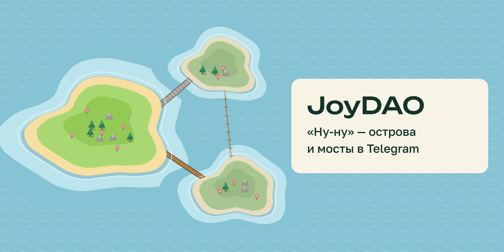

<p align="center"></p>

# JoyDAO · «Ну-ну»

**Строй мосты с людьми. По шагу в день.**

«Ну-ну» — игра в Telegram о том, насколько хорошо вы с друзьями знаете друг друга. У каждого свой остров, между друзьями растут мосты, а раз в неделю ты ставишь себе маленькое дело и отмечаешь, сделал ли его.

▶ **Играть:** [t.me/JOYDAO_bot/nunu](https://t.me/JOYDAO_bot/nunu) · канал [@joydao](https://t.me/joydao) · общий чат [@joydao_club](https://t.me/joydao_club)

*English below.*

## Как это работает

- 🏝 **Твой остров.** Отвечаешь на карточки-сцены, и остров растёт из ответов: цветы — когда идёшь к людям, деревья — когда уходишь в себя, камни — когда стоишь за себя. Это состояния, а не оценки.
- 🌉 **Мосты.** Отвечаешь о себе и угадываешь друга. Поняли друг друга — мост крепнет: канатный → подвесной → дощатый → каменный. Чем крепче мост, тем ближе остров друга на карте.
- 🌱 **«Чем удивишь себя на этой неделе?»** Маленькое дело в формате «если…, то…» — одно или вместе с другом. Бот напомнит, а сделанное распускается на острове.
- 👥 **Компания.** Одна ссылка или QR-код на всех: «угадайте меня».
- ✍️ **Своя ситуация.** Расскажи случай из жизни, а друг угадает, как ты поступил.
- 🍾 **Бутылка в море.** Партия с незнакомцем. Мост появляется, только если этого хотят оба.

Вход — через Telegram: ни паролей, ни кодов.

## На чём стоит

Каждое решение в игре опирается на исследование. Где опоры нет, мы так и пишем: гипотеза.

| Что в игре | Опора |
|---|---|
| Вопросы от лёгких к личным | Aron et al., 1997 — близость растёт от постепенной взаимной откровенности |
| «Кто я, по-твоему?» | Carlson (мета-восприятие); Boothby et al., 2018 — мы плохо угадываем, как нас видят другие |
| Стадии моста | Hall, 2018 — дружба крепнет от времени, проведённого вместе |
| Дело «если…, то…» | Gollwitzer & Sheeran, 2006 — намерения реализации |
| Мост можно починить | Silverman & Barasch, 2023 |
| Мост вместо счёта | соревнование отдаляет, совместное дело сближает |

Игра — компас, а не рентген: она показывает, куда ты смотришь, и не ставит диагнозов.

## Почему код открыт

- **Вход только через Telegram.** Каждый запрос проверяется подписью `initData` (сервер: [app/nunu.py](app/nunu.py)).
- **Видно только своё.** На карте только твои мосты; аватарок нет.
- **Незнакомцы — только по взаимному желанию.** Пожаловаться можно в два нажатия.
- **Никакой рекламы и продажи данных.**

## Запуск

```bash
python3 -m venv .venv && .venv/bin/pip install -r requirements.txt
cp .env.example .env        # впишите BOT_TOKEN и WEBAPP_URL
.venv/bin/python -m app.main
```

Тесты: `pip install pytest httpx && BOT_TOKEN=1:t python -m pytest -q tests/test_nunu.py tests/test_nunu_server.py tests/test_pause.py`.
Сервер: systemd-юнит и скрипт установки (nginx + certbot) — в [deploy/](deploy/).

```
static/nunu.html   игра: один файл, vanilla JS, рисованный SVG
app/nunu.py        API игры: партии, мосты, приглашения, бутылки, напоминания
app/pause.py       бот «Ну-ну»: профиль, кнопка «Играть»
app/main.py        точка входа
tests/             pytest
```

Старый JoyDao (портрет по дате рождения, совместимость, знакомства, JOY energy и монета на TON) не удалён: включается `LEGACY=1`, описание — в [docs/LEGACY.md](docs/LEGACY.md).

---

## English

**Build bridges with people. One step a day.**

*Nu-nu* is a Telegram game about how well you and your friends really know each other. Everyone has an island; bridges grow between friends; and once a week you set yourself one small thing to do and mark whether you did it.

- 🏝 **Your island** grows from your answers: flowers when you move toward people, trees when you step back, rocks when you stand your ground. States, not grades.
- 🌉 **Bridges.** Answer about yourself and guess your friend. Understand each other and the bridge gets stronger: rope → suspension → planks → stone.
- 🌱 **"How will you surprise yourself this week?"** One small *if–then* plan, alone or with a friend. The bot reminds you; what you did blooms on your island.
- 👥 **Party mode:** one link or QR code — everyone guesses you.
- 🍾 **Message in a bottle:** play with a stranger; a bridge appears only if both want it.

Every design decision is backed by research (Aron 1997, Gollwitzer & Sheeran 2006, Hall 2018, and others); anything without support is labelled a hypothesis.

▶ [Play in Telegram](https://t.me/JOYDAO_bot/nunu) · The interface is in Russian for now.

Stack: Python, aiogram 3, FastAPI, SQLite, and a single-file vanilla JS Mini App with hand-drawn SVG.

## License

[AGPL-3.0](LICENSE). You may use, study and modify the code. If you run a modified version as a service, you must publish your changes too.
